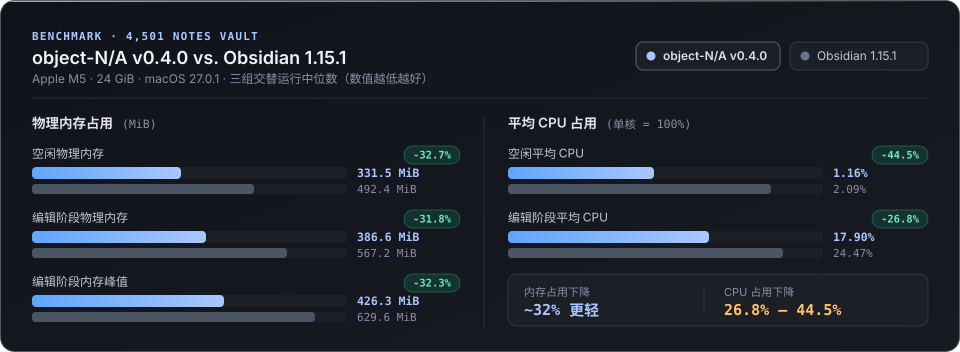

<div align="center">


# object-N/A

**一个基于 Go 与 MyGo 构建的本地优先 Markdown 知识工作区**

[](https://github.com/Ayntagn/object-N-A/releases/tag/v0.4.0)
[](https://go.dev/doc/)
[](https://mygo.egoist.dev/)
[](#构建与安装)
[](#界面语言)

<p>
  <a href="#功能特性">功能特性</a> ·
  <a href="#与-obsidian-的性能对比">性能对比</a> ·
  <a href="#快速开始">快速开始</a> ·
  <a href="#构建与安装">构建与安装</a> ·
  <a href="#vault-管理">Vault 管理</a> ·
  <a href="#技术栈">技术栈</a> ·
  <a href="#相关文档">相关文档</a>
</p>

</div>

---

**object-N/A** 是一款面向本地文件的 Markdown 桌面应用。它将笔记管理、文档编辑、实时预览、PDF 阅读与导出以及知识图谱整合在一个简洁的工作区中，让你在熟悉的文件系统里自由组织和管理文档。

打开一个 Vault，即可通过文件树浏览笔记、编辑 Markdown 文档、查看实时渲染结果，或通过知识图谱探索文档之间的关联。所有笔记均以普通文件的形式保存在本地，无需迁移到专有格式，也不依赖特定的云端服务。

---

## 功能特性

| 模块 | 说明 |
| :--- | :--- |
| **文件与 Vault 管理** | 以普通文件夹作为 Vault，通过文件树浏览和管理文档；支持直接打开已有笔记目录或创建新的 Vault。 |
| **Markdown 编辑与实时预览** | 集成编辑器支持边写边看，Markdown 预览与导出 PDF 默认跟随编辑器字体，保持阅读与写作的一致观感。 |
| **PDF 阅读与导出** | 在工作区内直接完成 PDF 阅读与导出；由 Markdown 生成的 PDF 支持按语言语法高亮代码块。 |
| **知识图谱** | 以可视化方式浏览笔记之间的链接与关联，快速定位和跳转上下文文档。 |
| **多文档视图** | 在同一工作区中同时打开和查看多份文档，减少在不同工具与窗口间频繁切换的成本。 |
| **中英双语界面** | 原生支持 **简体中文** 与 **English**，设置页、帮助菜单、功能指南、快捷键与欢迎页即时切换并在重启后保留。 |

---

## 与 Obsidian 的性能对比

<div align="center">
<picture>
  <source media="(prefers-color-scheme: dark)" srcset="docs/assets/benchmark-dark.svg" />
  <source media="(prefers-color-scheme: light)" srcset="docs/assets/benchmark-light.svg" />
  
</picture>
</div>

<br />

测试环境为 **Apple M5、24 GiB 内存、macOS 27.0.1**。两款应用打开同一份包含 **4,501 篇笔记** 的合成 Vault，并在同一篇约 **119 KiB** 的 Markdown 文档上回放分栏编辑。下表为三组交替运行的中位数（内存包含主进程及 WebKit 或 Electron 辅助进程，CPU 以单个核心为 100%）：

| 指标 | object-N/A v0.4.0 | Obsidian 1.15.1 | 对比降幅 |
| :--- | ---: | ---: | ---: |
| **空闲物理内存** | **331.5 MiB** | 492.4 MiB | `-32.7%` |
| **空闲平均 CPU** | **1.16%** | 2.09% | `-44.5%` |
| **编辑阶段物理内存** | **386.6 MiB** | 567.2 MiB | `-31.8%` |
| **编辑阶段物理内存采样峰值** | **426.3 MiB** | 629.6 MiB | `-32.3%` |
| **编辑阶段平均 CPU** | **17.90%** | 24.47% | `-26.8%` |

> 完整的逐轮内存、CPU、首次笔记窗口时间、测试方法与可复现夹具脚本，请参阅 [测量方法与逐轮数据](docs/PERFORMANCE.md)。

---

## 快速开始

> [!TIP]
> **直接下载预构建版本**：发布页提供 **macOS (arm64)**、**Windows (amd64)** 与 **Linux (amd64)** 的安装包及 SHA-256 校验和，前往 [GitHub Releases — v0.4.0](https://github.com/Ayntagn/object-N-A/releases/tag/v0.4.0) 即可获取；如需从源码自行构建，请按下方步骤操作。

### 环境要求

| 项目 | 要求 |
| :--- | :--- |
| **Go** | `1.27.3` |
| **MyGo** | `v0.8.3` |
| **macOS** | macOS 13 或更新版本（内置 WKWebView） |
| **Windows** | Windows 10 或更新版本（需 Edge WebView2 Runtime） |
| **Linux** | 图形桌面 + GTK 3 + WebKitGTK 4.1 |

### 1. 获取源码

克隆指定版本标签（也可前往 [GitHub Releases](https://github.com/Ayntagn/object-N-A/releases) 下载对应版本的源码压缩包）：

```bash
git clone --branch v0.4.0 --depth 1 https://github.com/Ayntagn/object-N-A.git
cd object-N-A
```

### 2. 准备资源

在项目根目录执行资源准备脚本：

```bash
go version
go run ./cmd/assets
```

> [!NOTE]
> 首次构建需要联网下载 Go 模块、锁定版本的字体与渲染资源，并准备带编辑器兼容修补的 MyGo 源码。上游资源文件合计约 **185 MB**。

---

## 构建与安装

| 平台 | 构建产物 | 默认安装位置 |
| :--- | :--- | :--- |
| **macOS** | `dist/object-n-a` | `~/Applications/object-N-A.app` |
| **Windows** | `dist/object-n-a.exe` | `%LOCALAPPDATA%\Programs\object-N-A` |
| **Linux** | `dist/object-n-a` | `~/.local/bin/object-n-a` |

### macOS

需要 **macOS 13** 或更新版本。

**构建与验证：**

```bash
mkdir -p dist
CGO_ENABLED=0 go build -trimpath -o dist/object-n-a ./cmd/app
./dist/object-n-a -version
```

**打包安装与启动：**

安装脚本会在当前用户的 `~/Applications` 目录下创建 `object-N-A.app`：

```bash
sh packaging/install-macos.sh dist/object-n-a
open "$HOME/Applications/object-N-A.app"
```

也可以在启动时直接指定 Vault：

```bash
open "$HOME/Applications/object-N-A.app" --args -vault "$HOME/Notes"
```

---

### Windows

需要 **Windows 10** 或更新版本。

> [!IMPORTANT]
> Markdown 预览和 PDF 阅读需要 **Microsoft Edge WebView2 Evergreen Runtime**。Windows 11 已默认内置；Windows 10 或缺失该运行时的系统可从 [Microsoft 官方网站](https://developer.microsoft.com/microsoft-edge/webview2/) 下载安装。

**在 PowerShell 中构建并运行：**

```powershell
New-Item -ItemType Directory -Force dist | Out-Null
$env:CGO_ENABLED = '0'
go build -trimpath -ldflags="-H=windowsgui" -o dist/object-n-a.exe ./cmd/app
.\dist\object-n-a.exe
```

**安装到当前用户目录并创建开始菜单快捷方式：**

安装脚本会将程序安装至 `%LOCALAPPDATA%\Programs\object-N-A` 并创建开始菜单快捷方式：

```powershell
powershell.exe -NoProfile -ExecutionPolicy RemoteSigned -File .\packaging\install-windows.ps1 -Binary .\dist\object-n-a.exe
```

**指定 Vault 启动：**

```powershell
.\dist\object-n-a.exe -vault "C:\path\to\Notes"
```

---

### Linux

需要 **GTK 3** 与 **WebKitGTK 4.1**。按发行版安装系统依赖：

- **Debian / Ubuntu**：`sudo apt install libwebkit2gtk-4.1-0`
- **Fedora**：`sudo dnf install gtk3 webkit2gtk4.1`
- **Arch Linux**：`sudo pacman -S gtk3 webkit2gtk-4.1`

**构建与运行：**

```bash
mkdir -p dist
CGO_ENABLED=0 go build -trimpath -o dist/object-n-a ./cmd/app
./dist/object-n-a
```

**安装二进制与桌面入口：**

安装脚本会将程序放置在 `~/.local/bin`，并注册对应的 `.desktop` 桌面入口：

```bash
sh packaging/install-linux.sh dist/object-n-a
"$HOME/.local/bin/object-n-a" -vault "$HOME/Notes"
```

---

## Vault 管理

object-N/A 直接使用普通文件夹作为 Vault，不引入专有文件格式。

启动应用后，你可以：
- **Open Vault**：打开已有的笔记目录。
- **Create Vault**：创建新的笔记工作区。

也可以在命令行中通过 `-vault` 参数直接打开指定目录（将示例路径替换为实际目录）：

```bash
object-n-a -vault "$HOME/Notes"
```

### 界面语言

object-N/A 支持 **简体中文** 和 **English** 两种界面语言，语言偏好会在重启后自动保留：

| 目标语言 | 设置路径 |
| :--- | :--- |
| **切换为简体中文** | `Settings` → `General` → `Settings & Help Language` → **简体中文** |
| **切换为 English** | `设置` → `通用` → `设置与帮助语言` → **English** |

切换后，设置页面、帮助菜单、功能指南、键盘快捷键与欢迎页面都会即时更新。

---

## 技术栈

项目基于 [MyGo](https://github.com/egoist/mygo) 构建，使用 Go 实现应用逻辑与原生窗口管理，并通过各平台系统原生 WebView 承载文档渲染与界面交互：

| 技术 | 用途 |
| :--- | :--- |
| **Go** | 应用核心逻辑与本地后端实现 |
| **MyGo** | 跨平台桌面应用框架与原生窗口管理 |
| **WebView** | 应用文档与界面渲染层 |
| **WKWebView** | macOS 系统原生渲染引擎 |
| **WebView2** | Windows 系统原生渲染引擎 |
| **WebKitGTK** | Linux 系统原生渲染引擎 |

---

## 相关文档

- [性能测试方法与逐轮数据](docs/PERFORMANCE.md)
- [第三方依赖说明](docs/THIRD_PARTY.md)
- [GitHub Releases](https://github.com/Ayntagn/object-N-A/releases)
- [MyGo 官方文档](https://mygo.egoist.dev/) · [Go 官方文档](https://go.dev/doc/)

---

## 致谢

感谢 Go、MyGo 以及项目所使用的所有开源依赖与工具的开发者。
